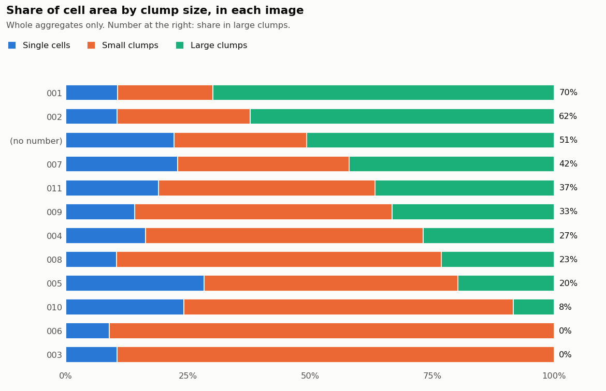
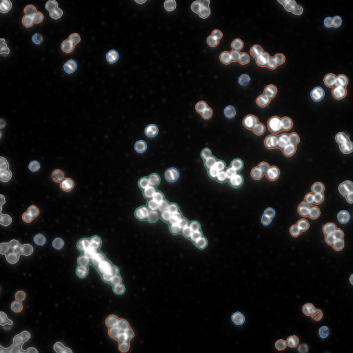
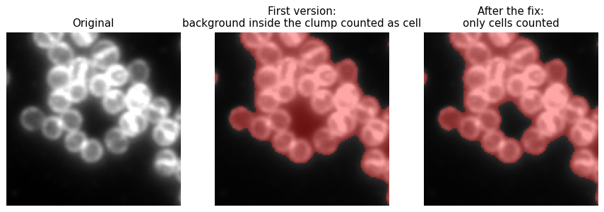

# Bacterial Aggregate Analysis

An automated workflow that takes a folder of fluorescence microscope images of bacteria and, for every image, measures how much of the image is covered by cells and how the cells group into clumps (aggregates). It saves the measurements as tables and an outlined copy of each image, so the results can be checked by eye.

It runs on a free public dataset of *Staphylococcus aureus* images. *S. aureus* naturally grows in grape-like clusters, which makes it a good test case for measuring aggregates. No private or lab data is used.

I built it with the help of an AI coding assistant (an LLM), then checked the output against the images, as described [below](#how-i-checked-the-results).

## What it does

For each image in the folder:

1. Finds the cell pixels. The membrane stain makes the cells glow, so the script keeps the pixels brighter than an automatically chosen cut-off. It then fills small holes, so a cell with a dim centre still counts as a whole cell.
2. Groups touching cells into aggregates. A lone cell counts as an aggregate of one.
3. Measures each aggregate's size (pixels and µm²) and brightness, and sorts it into a size class: single cell, small clump (about 2 to 5 cells) or large clump. Aggregates cut off by the image edge are flagged, because their full size is unknown.
4. Saves an outlined copy of the image, coloured by size class.

It is built to run unattended: an image that cannot be read is skipped and noted instead of stopping the run, and every run saves a log of its settings and of anything it skipped.

## How to run it

You need Python 3.10 or newer.

```bash
pip install -r requirements.txt
python download_data.py      # gets the 12 example images (about 17 MB)
python analyze_images.py     # analyses every image in data/images
python check_results.py      # checks the results (see below)
```

Or open `walkthrough.ipynb` in Jupyter. It runs the same workflow one step at a time, with a picture after each step.

To analyse your own folder of images:

```bash
python analyze_images.py --input path/to/images --output path/to/results
```

## Example result

The 12 images were processed in a few seconds. Three rows from `results/image_summary.csv`:

| image | % of image covered | aggregates | % of cell area in single cells | in small clumps | in large clumps |
|---|---|---|---|---|---|
| ..._001 | 28.8 | 80 | 10.6 | 19.5 | 69.8 |
| ..._004 | 5.1 | 31 | 16.3 | 56.9 | 26.8 |
| ..._009 | 11.7 | 58 | 14.1 | 52.7 | 33.2 |

The chart shows how the cells are organised in each image (`results/clump_sizes.png`):



Each aggregate outlined by size class (`results/outlines/`): blue for a single cell, orange for a small clump, green for a large clump, grey for one cut off by the edge.



### Output files

| file | what is in it |
|---|---|
| `results/image_summary.csv` | one row per image: cell area, % covered, number of aggregates, aggregate sizes, share of cell area in each size class |
| `results/aggregates.csv` | one row per aggregate: size in pixels and µm², brightness, size class, whether it touches the edge |
| `results/clump_sizes.png` | chart of the clump sizes in each image |
| `results/outlines/` | each image with its aggregates outlined by size class |
| `results/run_log.txt` | when it ran, the settings used, and any images skipped |
| `results/check/` | the outputs of the check described below |

## How I checked the results

A workflow that runs without errors can still give wrong numbers, so the output was checked in three ways.

**1. Reviewing a random sample by eye.** `check_results.py` picks 4 images at random and shows each one three ways, side by side: the original, the aggregates the script found, and the cells a person outlined by hand (the dataset includes these outlines). Looking through these pictures and zooming in on anything odd turned up problems that the summary numbers did not show.

**2. Comparing every image with the hand-drawn outlines.** The same script counts, for all 12 images, how many hand-drawn cells the workflow found, missed, or added.

**3. Checking the size classes.** The script counts the hand-drawn cells inside each aggregate, to see whether a "single cell" really is one cell and how many cells a clump holds.

### What the review found, and what was changed

- **Background counted as cell.** The hole-filling step was also filling background enclosed by a ring of cells inside a clump. The fix was to fill only holes smaller than one cell. A second look showed that some of the small holes still being filled are tiny gaps between tightly packed cells rather than cell centres. Comparing with the hand-drawn outlines showed this adds only about 0.3% to the total cell area, and keeping the step means fewer dim cells are left hollow, so it stays (see Known limits).

  

- **Unmatched aggregates.** 35 aggregates had no hand-drawn cell inside. Looking at them showed that 34 are real cells cut off by the image edge, which the person drawing outlines had skipped. They are now flagged in the `touches_edge` column, left out of the aggregate size statistics, and reported separately by the check.
- **Large clumps cut off by the edge.** Reviewing the size classes showed that large clumps are the most likely to be cut off, and cut-off clumps are left out of the size shares. The workflow now reports how much cell area this affects, in the `pct_cell_area_cut_off` column (see Known limits).

The unattended run was also tested on a folder containing a broken file, an empty file and a blank image. It finished normally, skipped the two unreadable files, and listed all three in the run log.

### Final check results

| check | result |
|---|---|
| hand-drawn cell pixels also found by the workflow | 92% to 99% per image |
| aggregates found by the workflow vs. hand-drawn clumps | 590 vs. 600 |
| hand-drawn cells missed completely | 52 of 1,641 (3%); the ones reviewed were very dim, out-of-focus cells |
| aggregates inside the image with no hand-drawn cell (possible false finds) | 1 of 590 |
| aggregates called single cells that hold exactly one hand-drawn cell | 88% of 221 |
| hand-drawn cells inside a small clump | 2 is typical, 7 at most |
| hand-drawn cells inside a large clump | 9 is typical, 5 to 35 |

### Known limits

- **Size class cut-offs fit this dataset.** They were chosen by comparing aggregate sizes with the hand-drawn cells in these same 12 images, so the 88% figure may be a little optimistic. Other cells need other cut-offs, which are set at the top of `analyze_images.py`.
- **Large clumps can be under-counted.** Aggregates cut off by the image edge are left out of the size shares. That is 5% to 29% of the cell area per image, and large clumps are the most likely to be cut off.
- **Larger cell area than the hand outlines.** The workflow's total cell area is about 1.5 times the hand-drawn area. The hand outlines were drawn as ellipses just inside each membrane, while the workflow includes the whole glowing membrane. That makes areas consistent between images, but they should not be compared directly with hand measurements.
- **Tiny gaps can count as cell.** Gaps between tightly packed cells that are smaller than one cell are counted as part of the clump. This adds about 0.3% to the total cell area.
- **Very dim cells can be missed.** Out-of-focus cells are sometimes missed or only partly found.
- **No count of individual cells.** The workflow counts aggregates, not the separate cells inside each clump.

## Data credit

Images: *DeepBacs – Staphylococcus aureus widefield segmentation dataset*, P. M. Pereira and M. Pinho, ITQB NOVA, Portugal. Zenodo, 2021. [doi:10.5281/zenodo.5550933](https://doi.org/10.5281/zenodo.5550933). License: [CC-BY 4.0](https://creativecommons.org/licenses/by/4.0/). Part of the DeepBacs project (Spahn et al., *Communications Biology*, 2022).
